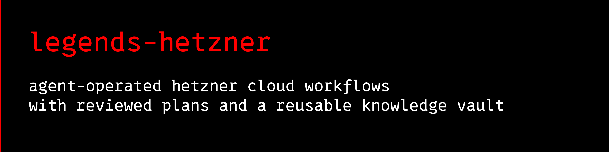
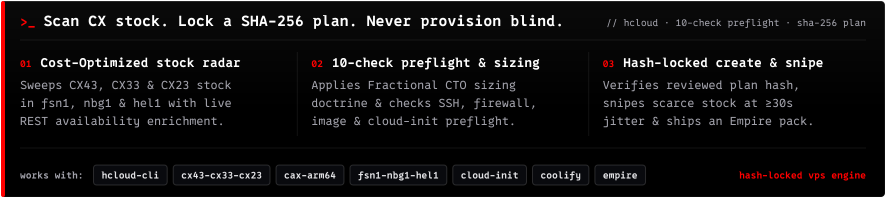
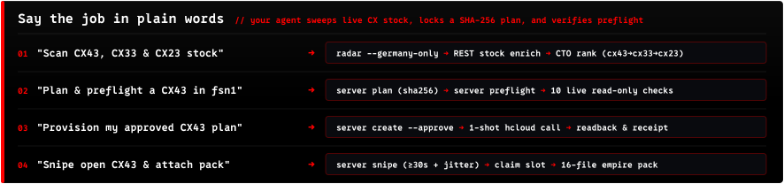
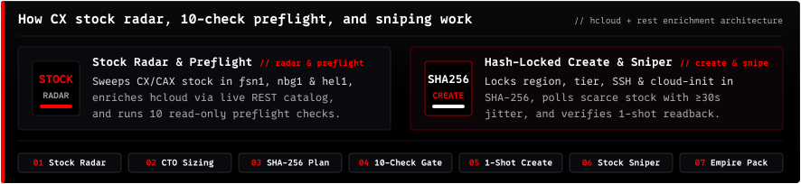
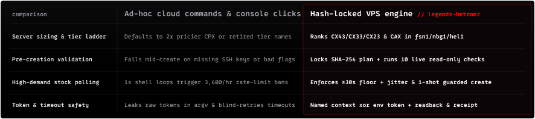

# 

[](https://github.com/avalonreset/legends-hetzner/releases/latest)
[](https://github.com/avalonreset/legends-hetzner/actions/workflows/checks.yml)
[](pyproject.toml)
[](docs/CTO-SIZING-AND-SNIPING.md)
[](LICENSE)

**Hetzner Cloud and VPS stock radar (`CX43`/`CX33`/`CX23` and `CAX`), Fractional CTO sizing advisor, 10-check read-only preflight gate, SHA-256 hash-locked provisioning CLI, and rate-limit-safe capacity sniper for coding agents.**


```text
Install or update legends-hetzner via cto-legends (https://github.com/avalonreset/cto-legends): run `cto-legends install legends-hetzner --apply`, then `cto-legends handoff legends-hetzner` and follow the returned JSON recipe to verify `legends-hetzner`.
```



## Why `legends-hetzner` exists

Most agent-driven cloud setups treat server provisioning as ad-hoc shell improvisation:

1. **Defaulting to 2x pricier tiers or retired instance names:** Without live hypervisor stock data, coding agents guess retired Hetzner instance names from training data or fall back to Regular Purpose (`CPX`) servers that cost more than twice as much per GB of RAM when Cost-Optimized `CX43`, `CX33`, `CX23`, or `CAX` tiers are open in Germany (`fsn1`, `nbg1`) or Finland (`hel1`).
2. **Failing mid-create or spinning up duplicate billable servers:** Running raw `hcloud server create` commands without an immutable plan or read-only preflight fails midway on missing SSH keys, deprecated OS images, CPU architecture mismatches, or removed `--datacenter` flags. Worse, when a network call times out, an unconstrained agent retries the command and creates duplicate billable VPS instances.
3. **Triggering API rate-limit bans while polling sold-out stock:** When scarce Cost-Optimized capacity is temporarily out of stock, improvised 1-second shell loops hammer the Hetzner Cloud API and exhaust the 3,600 requests/hour quota right before capacity opens.

`legends-hetzner` wraps the official `hcloud` CLI in a Python 3.11+ standard-library runtime (zero third-party pip dependencies, no PowerShell dependency, and no ambient daemon) that separates live discovery from infrastructure writes. Every server creation is locked behind an offline `sha256:<64hex>` plan, verified by 10 read-only preflight checks, executed in at most one guarded `hcloud` invocation with immediate readback verification, and paired with an optional 16-file operations knowledge pack for [`legends-empire`](https://github.com/avalonreset/legends-empire).

## Ask in plain english

Once [`cto-legends`](https://github.com/avalonreset/cto-legends) is installed, you ask your coding agent in plain english. It sweeps live European stock, writes an immutable SHA-256 server plan, verifies all 10 read-only preflight checks, and provisions or snipes capacity with a redacted readback receipt:



## Architecture: live CX stock radar, 10-check preflight, and hash-locked sniping



### 1. Cost-Optimized stock radar and Fractional CTO sizing doctrine (`CX` vs `CAX`)

Hetzner Cloud's Cost-Optimized (`cost_optimized`) line is hosted in three European locations: **Falkenstein (`fsn1`, Germany)**, **Nuremberg (`nbg1`, Germany)**, and **Helsinki (`hel1`, Finland)**. Regular Purpose (`CPX`) and General Purpose (`CCX`) lines cost more than twice as much per GB of RAM. When running against older `hcloud` binaries (such as `1.61.0`) that omit `locations[].available` and `category` from CLI JSON output, `legends-hetzner` automatically enriches server-type catalogs via hardened read-only REST (`GET /v1/server_types` with redirects disabled and ambient proxies ignored).

| Priority | Server Tier | Arch | Specs (vCPU / RAM / NVMe) | CTO Role & Sizing Guidance |
| :--- | :--- | :--- | :--- | :--- |
| **1 (Default)** | **`cx43`** | `x86` | **8 vCPU · 16 GB · 160 GB** | **Ideal Fractional CTO Default.** Best price-to-headroom balance for a consolidated single-server stack ([`legends-coolify`](https://github.com/avalonreset/legends-coolify), reverse proxy, websites, databases, and workers) with 100% `linux/amd64` compatibility. |
| **2 (Sweet Spot)** | **`cx33`** | `x86` | **4 vCPU · 8 GB · 80 GB** | **Budget Sweet Spot.** Delivers 2x the CPU and RAM of a `cpx22` fallback at less than half the monthly cost; supports clean in-place rescale from an 80 GB `cpx22` or 40 GB `cx23` in the same location. |
| **3 (Starter)** | **`cx23`** | `x86` | **2 vCPU · 4 GB · 40 GB** | **Entry Starter Seat.** Sufficient for a lightweight static or staging stack (configure a **4 GB swapfile** and `NODE_OPTIONS=--max-old-space-size=2048` to prevent Node build OOMs) while waiting to rescale up to `cx33` or `cx43`. |
| **4 (Ceiling)** | **`cx53`** | `x86` | **16 vCPU · 32 GB · 320 GB** | **Single-Box Consolidation Ceiling.** Consolidating onto one `cx43` or `cx53` is strongly preferred over running multiple small Hetzner VPS instances. |
| **5-8 (ARM64)** | **`cax31` / `cax21` / `cax11` / `cax41`** | `arm` | **2-16 vCPU · 4-32 GB · 40-320 GB** | **Ampere Altra ARM64 Alternatives.** Non-hyperthreaded ARM64 cores when `x86` tiers are unavailable and every workload supports `linux/arm64` (cannot rescale in-place into `x86` `CX` tiers). |

### 2. SHA-256 server plans and the 10-check preflight gate

Before any server can be created, `legends-hetzner server plan` writes an offline JSON plan pinned by a canonical `sha256:<64hex>` content hash, binding your target `--context` (or `HCLOUD_TOKEN` mode), server tier, location, OS image, SSH keys, and `cloud-init` user-data digest (refusing symlinks and existing output files fail-closed). `legends-hetzner server preflight` then verifies 10 read-only checks against live project state:

| Surface | `legends-hetzner` Command | What It Verifies or Executes |
| :--- | :--- | :--- |
| **Environment Readiness** | `doctor [--live]` | Distinguishes offline Python 3.11+ and `hcloud` binary readiness from a live read-only Hetzner Cloud location probe. |
| **Inventory & Catalog** | `inventory`, `catalog` | Audits existing servers and live `server-types`, `locations`, `images`, and `ssh-keys` with automatic secret token redaction. |
| **Stock Radar & Watch** | `radar [--watch]` | Sweeps live `cost_optimized` capacity across `fsn1`, `nbg1`, and `hel1`, ranks open tiers by Fractional CTO priority, and optionally watches at jittered intervals (`>= 30`s). |
| **Immutable Plan & 10-Check Gate** | `server plan`, `server preflight` | Verifies `name_available`, `server_type_exists`, `location_exists`, `image_exists`, `ssh_keys_exist`, `location_supported`, `location_available`, `location_not_deprecated`, `image_not_deprecated`, and `arch_compatible`. |
| **1-Shot Create & Capacity Sniper** | `server create`, `server snipe` | Requires explicit `--approve` and matching `--plan-hash`, polls sold-out tiers safely (`--interval >= 30`s, default `60`s + jitter), executes at most one create call, verifies via live readback, and writes a redacted receipt. |
| **Packaged Runbooks** | `resources` | Returns absolute paths to the installed agent recipe, Ubuntu 24.04 `cloud-init` baseline, and 16-file `legends.knowledge-pack/v1` operations library. |

### 3. Direct placement tests (`--allow-unavailable`) and rate-limit-safe sniping (`server snipe`)

- **Cached catalog flag vs live placement scheduler:** Hetzner's catalog availability flag (`available=false`) is a cached indicator that grays out tiers in the Web Console UI, while the live placement scheduler behind `hcloud server create` (`POST /v1/servers`) evaluates real-time hypervisor capacity at creation time. When all 9 non-capacity preflight checks pass, you can test direct API placement with `--allow-unavailable` (previewing first with `--dry-run`).
- **Rate-limit-safe capacity sniper:** When live placement reports `resource_unavailable`, `server snipe` enforces a strict 30-second minimum polling floor (`--interval 30..3600`, default `60`s) with positive random jitter (`--jitter 0..60`, default `10`s) and bounded `--max-polls` (`1..120`, default `30`), consuming roughly 8% of Hetzner's hourly API quota and aborting immediately on Poll 1 if any non-capacity check fails.

## Ad-hoc cloud commands vs `legends-hetzner`



## Quick start

```sh
# 1. Configure a named hcloud context (or export HCLOUD_TOKEN; never combine both)
hcloud context create my-project
legends-hetzner --context my-project doctor --live
legends-hetzner --context my-project inventory

# 2. Sweep live Cost-Optimized x86 stock and Fractional CTO recommendations
legends-hetzner --context my-project radar --germany-only --types cx43,cx33,cx23
legends-hetzner --context my-project catalog --kind ssh-keys

# 3. Create an immutable, SHA-256 hash-pinned server plan offline
legends-hetzner --context my-project server plan \
  --name example-app --type cx43 --location fsn1 \
  --image ubuntu-24.04 --ssh-key my-key --out ./server-plan.json

# 4. Run the 10-check read-only preflight gate
legends-hetzner --context my-project server preflight --plan ./server-plan.json

# 5. Preview guarded creation (or pass --allow-unavailable when catalog availability lags)
legends-hetzner --context my-project server create \
  --plan ./server-plan.json --plan-hash sha256:REVIEWED_HASH \
  --approve --dry-run --receipt ./receipt.json

# 6. Poll sold-out capacity at rate-limit-safe jittered intervals (>= 30s)
legends-hetzner --context my-project server snipe \
  --plan ./server-plan.json --plan-hash sha256:REVIEWED_HASH \
  --approve --dry-run --receipt ./snipe-receipt.json \
  --interval 60 --jitter 10 --max-polls 30
```

## Reference

<details>
<summary><strong>Exit-code contract, receipt statuses, and Empire knowledge shelf</strong></summary>

All commands emit structured JSON on `stdout` and sanitized diagnostics on `stderr` (see [`docs/CLI-CONTRACT.json`](docs/CLI-CONTRACT.json)):

| Exit Code | Constant | Meaning |
| ---: | :--- | :--- |
| `0` | `OK` | Command succeeded (`doctor`, `inventory`, `catalog`, `radar`, `server plan`, `server preflight`, `server create`, `server snipe`, `resources`). |
| `1` | `LOCAL_OR_CLI_ERROR` | Missing `hcloud` binary, non-zero `hcloud` exit on read-only probes, timeout, or invalid JSON output. |
| `2` | `PLAN_OR_USAGE_ERROR` | Invalid CLI flags, tampered or stale plan file (`> 24`h), hash mismatch, missing `--approve`, ambiguous auth, or unsafe poll interval (`< 30`s). |
| `3` | `PREFLIGHT_BLOCKED` | One or more live preflight checks failed (`name_available`, `location_available`, `arch_compatible`, etc.), or a `--watch` / `snipe` window completed without open stock. |
| `4` | `CREATE_OR_UNCERTAIN` | `hcloud server create` failed or returned an ambiguous result (`uncertain_exists`, `uncertain_missing`, `uncertain_unknown`); inspect the receipt and readback before retrying. |
| `5` | `AUTH_MISSING` | Live provider command invoked without `HCLOUD_TOKEN` or `--context NAME`. |

The module also ships a 16-file `legends.knowledge-pack/v1` operations library under [`knowledge/hetzner/`](knowledge/hetzner/pack.json) (`cto-sizing-and-sniping.md`, `preflight.md`, `ssh-bootstrap.md`, `coolify-boundary.md`, `backups-restore.md`, `troubleshooting.md`, and audit templates). Its suggested attachment path in a selected [`legends-empire`](https://github.com/avalonreset/legends-empire) vault is `wiki/library/legends-hetzner/hetzner`. Installing `legends-hetzner` never modifies a vault automatically; see [`docs/KNOWLEDGE-PACK.md`](docs/KNOWLEDGE-PACK.md) and [`knowledge/hetzner/vault/index.md`](knowledge/hetzner/vault/index.md).

</details>

<details>
<summary><strong>Agent setup (via <code>cto-legends</code>) and standalone installation</strong></summary>

### Agent setup (via `cto-legends`)

Part of [`cto-legends`](https://github.com/avalonreset/cto-legends). `cto-legends` is the single registered router skill; this repository vendors a byte-exact copy at [`skills/cto-legends/SKILL.md`](skills/cto-legends/SKILL.md).

Run `cto-legends handoff legends-hetzner` and read the returned installed recipe and task-readiness checks. If the module is missing, preview setup with `cto-legends install legends-hetzner`, perform the authorized setup, then repeat the handoff. Use `cto-legends check-updates` to compare your installed version with the catalog and published release. See [`docs/AGENT-RECIPE.md`](docs/AGENT-RECIPE.md) for the standalone recipe.

The separate official [`hcloud` CLI](https://github.com/hetznercloud/cli) must be installed using its documented Windows, macOS, or Linux instructions. This module never silently installs or upgrades external binaries.

```sh
python -m pip install -e .
legends-hetzner doctor
legends-hetzner resources
```

</details>

<details>
<summary><strong>Repository layout, verification, and scope limits</strong></summary>

```text
Operator / Coding Agent
  -> legends-hetzner radar (live CX/CAX stock matrix + REST enrichment + CTO tier ranking)
  -> legends-hetzner server plan (offline JSON plan + SHA-256 content hash)
  -> legends-hetzner server preflight (10 live read-only safety checks)
  -> legends-hetzner server create / snipe (single guarded hcloud invocation + readback receipt)
```

- [`legends_hetzner/`](legends_hetzner/__init__.py): Python 3.11+ stdlib CLI entry point, `hcloud` argv adapter (`shell=False`), REST `server_types` enricher, plan hash verifier, and rate-limit-safe radar/sniper engine.
- [`docs/`](docs/AGENT-RECIPE.md): [Agent recipe](docs/AGENT-RECIPE.md), [CTO sizing & sniping guide](docs/CTO-SIZING-AND-SNIPING.md), [Preflight checks](docs/PREFLIGHT.md), [Knowledge pack](docs/KNOWLEDGE-PACK.md), [Live canary](docs/LIVE-CANARY.md), and [Tested scope](docs/VALIDATION.md).
- [`cloud-init/minimal.yaml`](cloud-init/minimal.yaml): Reviewable Ubuntu 24.04 cloud-init baseline.
- [`scripts/check_release.py`](scripts/check_release.py): Strict release, contract, link, and privacy fingerprint gate.

```sh
python -m unittest discover -s tests -v
python scripts/check_release.py --strict
```

This is a focused Hetzner Cloud server toolkit, not a wrapper for every Hetzner product. It does not administer Hetzner Robot bare-metal servers, manage billing, modify DNS records (use [`legends-cloudflare`](https://github.com/avalonreset/legends-cloudflare)), inspect Coolify applications (use [`legends-coolify`](https://github.com/avalonreset/legends-coolify)), or replace full Terraform/OpenTofu state reconciliation.

</details>

## Contributing, security, and license

See [CONTRIBUTING.md](CONTRIBUTING.md), [CODE_OF_CONDUCT.md](CODE_OF_CONDUCT.md), [SECURITY.md](SECURITY.md), [SUPPORT.md](SUPPORT.md), [PRIVACY.md](PRIVACY.md), [CITATION.cff](CITATION.cff), and [THIRD_PARTY_NOTICES.md](THIRD_PARTY_NOTICES.md).

Independent software by Benjamin Samar (Avalon Reset), released under the [MIT License](LICENSE). Not affiliated with or endorsed by Hetzner Online GmbH.

## Start here

Paste the [agent handoff block](#top) at the top of this page into your coding agent, let it wire the `cto-legends` router skill, and speak your task in plain English.

Running a company and not a terminal? Founders and operators who want this way of working applied directly to their own business stack have one route: message Avalon Reset at [cto-legends.com/dm](https://cto-legends.com/dm) or start with a 48-hour diagnostic at [cto-legends.com/home#home-offer](https://cto-legends.com/home#home-offer). The desk is async, so the conversation starts the moment you write and nobody forces you onto a sales call.

<p align="center"><a href="https://cto-legends.com/dm"></a></p>

<p align="center"><a href="https://github.com/stars/avalonreset/lists/cto-legends"></a></p>

**Specification & benchmarks on cto-legends.com:**
- **Module specification & architecture matrix:** [cto-legends.com/modules/legends-hetzner](https://cto-legends.com/modules/legends-hetzner)
- **Related engineering dispatches:** [Hetzner vs DigitalOcean: The $850 Cloud Invoice Audit](https://cto-legends.com/blog?post=hetzner-vs-digitalocean) · [How Zapier Alternatives Bill a 500-Item Webhook Loop](https://cto-legends.com/blog?post=zapier-alternatives) · [How to Vet an AI Implementation Consultant in 15 Minutes](https://cto-legends.com/blog?post=ai-implementation-consultant)
- **Ecosystem hub:** [cto-legends.com/home](https://cto-legends.com/home)
