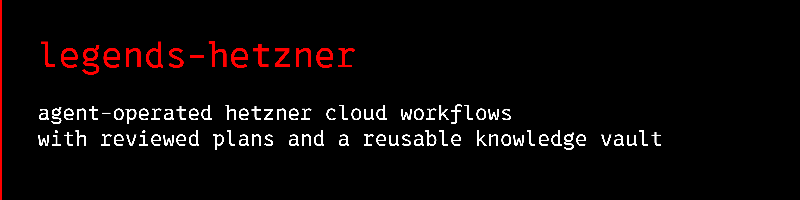

<a name="legends-hetzner"></a>

# 

[](https://github.com/avalonreset/legends-hetzner/releases/latest)
[](https://github.com/avalonreset/legends-hetzner/actions/workflows/checks.yml)
[](LICENSE)

`legends-hetzner` is an open source Hetzner Cloud CLI toolkit, Fractional CTO sizing advisor, and rate-limit-safe capacity sniper for AI coding agents and developers. It helps you inspect Hetzner VPS projects, sweep live `cost_optimized` (`CX`/`CAX`) server stock across European locations (`fsn1`, `nbg1`, `hel1`), prepare SHA-256 hash-pinned provisioning plans, run 10-check preflight validation on Ubuntu 24.04 cloud-init inputs, and attach a 16-file operations knowledge pack across sessions.

Built on the official `hcloud` CLI using the Python 3.11+ standard library only (zero third-party pip dependencies, no PowerShell dependency, and no MCP server required). Hetzner credentials are needed only for live provider operations; offline readiness, plan generation, and the Markdown operations library work without credentials.

**Quick links:** [Releases](https://github.com/avalonreset/legends-hetzner/releases) · [Agent entry point](AGENTS.md) · [Module recipe](docs/AGENT-RECIPE.md) · [CTO sizing & sniping guide](docs/CTO-SIZING-AND-SNIPING.md) · [Preflight checks](docs/PREFLIGHT.md) · [Knowledge pack](docs/KNOWLEDGE-PACK.md) · [Tested scope](docs/VALIDATION.md) · [Contributing](CONTRIBUTING.md) · [MIT license](LICENSE)

## Table of Contents

- [What you can do](#what-you-can-do)
- [Fractional CTO sizing doctrine (`CX` vs `CAX`)](#fractional-cto-sizing-doctrine-cx-vs-cax)
- [Agent setup (via `cto-legends`)](#agent-setup-via-cto-legends)
- [Quick start: inspect your Hetzner Cloud project](#quick-start-inspect-your-hetzner-cloud-project)
- [Commands and exit-code contract](#commands-and-exit-code-contract)
- [Optional Empire knowledge shelf](#optional-empire-knowledge-shelf)
- [Architecture and how it works](#architecture-and-how-it-works)
- [Frequently asked questions](#frequently-asked-questions)
- [Development, contributing, and license](#development-contributing-and-license)

## What you can do

| Workflow | Command | Primary outcome |
| --- | --- | --- |
| Environment readiness | `legends-hetzner doctor [--live]` | Distinguish offline Python/`hcloud` binary readiness from a live read-only Hetzner Cloud API probe. |
| Server inventory | `legends-hetzner inventory` | Read structured JSON server inventory using an explicit `HCLOUD_TOKEN` or named `--context` (redacting secret tokens). |
| Provider catalog | `legends-hetzner catalog` | Inspect live `server-types`, `locations`, `images`, and `ssh-keys` (automatically enriching `hcloud 1.61.0` output with REST `category` and `available` fields). |
| Stock radar & CTO advisor | `legends-hetzner radar` | Sweep live `cost_optimized` (`CX23`-`CX53` x86 and `CAX11`-`CAX41` ARM64) capacity across `fsn1`, `nbg1`, and `hel1`, rank tiers by Fractional CTO priority, and optionally `--watch` at jittered intervals (`>= 30`s). |
| Immutable server plan | `legends-hetzner server plan` | Write an offline, reviewable JSON provisioning plan pinned by a canonical `sha256:<64hex>` content hash, selected SSH keys, context binding, and `cloud-init` user-data digest. |
| 10-check preflight | `legends-hetzner server preflight` | Verify 10 read-only checks against live Hetzner Cloud state before any purchase (or pass `--allow-unavailable` to test direct API placement when catalog availability flags lag). |
| Guarded server create | `legends-hetzner server create` | Require explicit `--approve` and the reviewed `--plan-hash`, execute at most one `hcloud server create` call, verify via readback, and write a redacted receipt. |
| Rate-limit-safe sniper | `legends-hetzner server snipe` | Poll read-only preflight at bounded, jittered intervals (`--interval >= 30`s, default `60`s + `0..60`s jitter), abort immediately on Poll 1 if any non-capacity check fails, and execute one guarded create when capacity opens. |
| Packaged resources | `legends-hetzner resources` | Return absolute paths to the installed agent recipe, `cloud-init` baseline, and 16-file `legends.knowledge-pack/v1` directory. |

This is a focused Hetzner Cloud operator toolkit, not a wrapper for every Hetzner product. It does not administer Hetzner Robot bare-metal servers, automatically migrate applications, manage billing, or replace full Terraform/OpenTofu state reconciliation.

## Fractional CTO sizing doctrine (`CX` vs `CAX`)

Hetzner Cloud's **Cost-Optimized (`cost_optimized`)** line is hosted exclusively in three European data centers: **Falkenstein (`fsn1`, Germany)**, **Nuremberg (`nbg1`, Germany)**, and **Helsinki (`hel1`, Finland)**. Regular Purpose (`CPX`) and General Purpose (`CCX`) lines cost more than twice as much per GB of RAM.

| Priority | Server Tier | Arch | Specs (vCPU / RAM / NVMe) | CTO Role & Sizing Guidance |
| :--- | :--- | :--- | :--- | :--- |
| **1 (Default)** | **`cx43`** | `x86` | **8 vCPU · 16 GB · 160 GB** | **Ideal Fractional CTO Default.** Best price-to-headroom balance for a consolidated single-server stack (Coolify, reverse proxy, websites, databases, and automation workers) with 100% `linux/amd64` compatibility. |
| **2 (Sweet Spot)** | **`cx33`** | `x86` | **4 vCPU · 8 GB · 80 GB** | **Budget Sweet Spot.** Delivers 2x the CPU and RAM of a `cpx22` fallback at less than half the monthly cost; supports clean in-place rescale from an 80 GB `cpx22` or 40 GB `cx23` in the same location. |
| **3 (Starter)** | **`cx23`** | `x86` | **2 vCPU · 4 GB · 40 GB** | **Entry Starter Seat.** Sufficient for Coolify and a lightweight static or Astro staging site (configure a **4 GB swapfile** and `NODE_OPTIONS=--max-old-space-size=2048` to prevent Node build OOMs) while waiting to rescale up to `cx33` or `cx43`. |
| **4 (Ceiling)** | **`cx53`** | `x86` | **16 vCPU · 32 GB · 320 GB** | **Single-Box Consolidation Ceiling.** Consolidating onto one `cx43` or `cx53` is strongly preferred over running multiple small Hetzner VPS instances. |
| **5-8 (ARM64)** | **`cax31` / `cax21` / `cax11` / `cax41`** | `arm` | **2-16 vCPU · 4-32 GB · 40-320 GB** | **Ampere Altra ARM64 Alternatives.** Non-hyperthreaded ARM64 cores when `x86` tiers are unavailable and every workload supports `linux/arm64` (cannot rescale in-place into `x86` `CX` tiers). |

See [`docs/CTO-SIZING-AND-SNIPING.md`](docs/CTO-SIZING-AND-SNIPING.md) for in-place rescale rules (same location, same CPU architecture, and disk-size monotonicity) and the two-layer catalog vs. live placement API workflow.

## Agent setup (via `cto-legends`)

Part of the [`cto-legends`](https://github.com/avalonreset/cto-legends) ecosystem. `cto-legends` is the single registered router skill; this repository vendors a byte-exact copy at [`skills/cto-legends/SKILL.md`](skills/cto-legends/SKILL.md).

Install or update `legends-hetzner` through the router:

```console
cto-legends sync
cto-legends sync --apply
cto-legends install legends-hetzner
cto-legends install legends-hetzner --apply
cto-legends handoff legends-hetzner
cto-legends run legends-hetzner -- doctor
```

If you already have `cto-legends` installed, running `cto-legends handoff legends-hetzner` or `cto-legends check-updates` automatically checks the canonical catalog for new `legends-hetzner` releases and guides your agent through `cto-legends sync --apply` and `cto-legends update legends-hetzner --apply`.

The separate official [`hcloud` CLI](https://github.com/hetznercloud/cli) must be installed using its documented Windows, macOS, or Linux instructions. This module never silently installs or upgrades external binaries.

For standalone Python use outside `cto-legends`, install the tagged release into a virtual environment:

```console
python -m pip install "git+https://github.com/avalonreset/legends-hetzner.git@v0.1.5"
legends-hetzner doctor
legends-hetzner resources
```

<a name="first-useful-workflow"></a>

## Quick start: inspect your Hetzner Cloud project

Configure a named project context using the official `hcloud` CLI's interactive setup (or export `HCLOUD_TOKEN` in your environment; never combine both at once):

```console
hcloud context create my-project
legends-hetzner --context my-project doctor --live
legends-hetzner --context my-project inventory
legends-hetzner --context my-project radar --germany-only --arch x86
legends-hetzner --context my-project catalog --kind ssh-keys
```

### Plan, preflight, and snipe a Cost-Optimized Hetzner VPS

1. **Sweep live stock and CTO recommendations:**

```console
legends-hetzner --context my-project radar --germany-only --types cx43,cx33,cx23
```

2. **Create an immutable, hash-pinned server plan (offline):**

```console
legends-hetzner --context my-project server plan --name example-app --type cx43 --location fsn1 --image ubuntu-24.04 --ssh-key my-key --out ./server-plan.json
```

3. **Run the 10-check read-only preflight:**

```console
legends-hetzner --context my-project server preflight --plan ./server-plan.json
```

4. **Test direct API placement or run the rate-limit-safe sniper:**

Hetzner's catalog availability flag (`available=false`) is a cached indicator that grays out tiers in the Web Console UI, while the live placement scheduler behind `hcloud server create` (`POST /v1/servers`) evaluates real-time hypervisor capacity at creation time. When all 9 non-capacity preflight checks pass, you can test direct API placement with `--allow-unavailable` (previewing first with `--dry-run`):

```console
legends-hetzner --context my-project server preflight --plan ./server-plan.json --allow-unavailable
legends-hetzner --context my-project server create --plan ./server-plan.json --plan-hash sha256:REVIEWED_HASH --approve --allow-unavailable --dry-run --receipt ./receipt.json
```

If live placement also reports `resource_unavailable`, use `server snipe` to poll read-only capacity at rate-limit-safe jittered intervals (`--interval >= 30`s, default `60`s) and execute at most one create call when capacity opens:

```console
legends-hetzner --context my-project server snipe --plan ./server-plan.json --plan-hash sha256:REVIEWED_HASH --approve --dry-run --receipt ./snipe-receipt.json --interval 60 --jitter 10 --max-polls 30
```

Removing `--dry-run` requests a paid server creation. A disposable live canary has verified creation, readback, key-based SSH, Ubuntu 24.04 cloud-init, and identity-checked cleanup from Windows. See [`docs/VALIDATION.md`](docs/VALIDATION.md) and [`docs/LIVE-CANARY.md`](docs/LIVE-CANARY.md).

## Commands and exit-code contract

All commands emit structured JSON on `stdout` and sanitized diagnostics on `stderr` (see [`docs/CLI-CONTRACT.json`](docs/CLI-CONTRACT.json)):

| Exit Code | Constant | Meaning |
| ---: | :--- | :--- |
| `0` | `OK` | Command succeeded (`doctor`, `inventory`, `catalog`, `radar`, `server plan`, `server preflight`, `server create`, `server snipe`, `resources`). |
| `1` | `LOCAL_OR_CLI_ERROR` | Missing `hcloud` binary, non-zero `hcloud` exit on read-only probes, timeout, or invalid JSON output. |
| `2` | `PLAN_OR_USAGE_ERROR` | Invalid CLI flags, tampered or stale plan file (`> 24`h), hash mismatch, missing `--approve`, ambiguous auth, or unsafe poll interval (`< 30`s). |
| `3` | `PREFLIGHT_BLOCKED` | One or more live preflight checks failed (`name_available`, `location_available`, `arch_compatible`, etc.), or a `--watch` / `snipe` window completed without open stock. |
| `4` | `CREATE_OR_UNCERTAIN` | `hcloud server create` failed or returned an ambiguous result (`uncertain_exists`, `uncertain_missing`, `uncertain_unknown`); inspect the receipt and readback before retrying. |
| `5` | `AUTH_MISSING` | Live provider command invoked without `HCLOUD_TOKEN` or `--context NAME`. |

## Optional Empire knowledge shelf

The module ships a 16-file `legends.knowledge-pack/v1` operations library under [`knowledge/hetzner/`](knowledge/hetzner/pack.json). Its suggested attachment path in a selected [`legends-empire`](https://github.com/avalonreset/legends-empire) vault is `wiki/library/legends-hetzner/hetzner`.

- **No automatic vault writes:** Installing `legends-hetzner` never modifies a vault. Knowledge pack attachment is a separate preview-and-apply transaction in `legends-empire` (`0.3.1+`).
- **Preserves local decisions:** Upgrading the attached pack updates unmodified reference files while preserving your user-owned `index.md` and refusing to overwrite locally edited notes.
- **Cross-platform support:** Tested on Linux, macOS, and native Windows local fixed NTFS (`Python 3.11+`). See [`docs/KNOWLEDGE-PACK.md`](docs/KNOWLEDGE-PACK.md) and [`knowledge/hetzner/vault/index.md`](knowledge/hetzner/vault/index.md).

## Architecture and how it works

```text
Operator / AI Coding Agent
  -> legends-hetzner radar (live CX/CAX stock matrix + CTO tier ranking)
  -> legends-hetzner server plan (offline JSON plan + SHA-256 content hash)
  -> legends-hetzner server preflight (10 live read-only safety checks)
  -> legends-hetzner server create / snipe (single guarded hcloud invocation + readback receipt)
```

- [`legends_hetzner/`](legends_hetzner/__init__.py): Python 3.11+ stdlib CLI entry point, `hcloud` argv adapter (`shell=False`), REST `server_types` enricher, plan hash verifier, and rate-limit-safe radar/sniper engine.
- [`knowledge/hetzner/`](knowledge/hetzner/pack.json): 16-file source-cited operations library (`cto-sizing-and-sniping.md`, `preflight.md`, `ssh-bootstrap.md`, `coolify-boundary.md`, `backups-restore.md`, `troubleshooting.md`, and audit templates).
- [`cloud-init/minimal.yaml`](cloud-init/minimal.yaml): Reviewable Ubuntu 24.04 cloud-init baseline.
- [`scripts/check_release.py`](scripts/check_release.py): Strict release, contract, link, and privacy fingerprint gate.

## Frequently asked questions

### Does `legends-hetzner` replace the official `hcloud` CLI?
No. It wraps the official `hcloud` CLI with an agent-safe review procedure: separate local readiness from live API probes, write a SHA-256 hash-pinned server plan, run 10 preflight checks against live provider data, and require explicit `--approve` before executing a single create call.

### Why does `legends-hetzner` prioritize `CX43`, `CX33`, and `CX23` in Germany and Finland?
Hetzner's `cost_optimized` line (`CX23`-`CX53` x86 and `CAX11`-`CAX41` ARM64 in `fsn1`, `nbg1`, and `hel1`) delivers more than double the RAM and vCPU per dollar compared to `regular_purpose` (`CPX`) plans, and `x86` `CX` servers offer universal `linux/amd64` container compatibility plus in-place rescaling up the `CX23 -> CX33 -> CX43 -> CX53` ladder.

### How does `server snipe` avoid hitting Hetzner Cloud API rate limits?
`radar --watch` and `server snipe` enforce a strict minimum poll interval of 30 seconds (`--interval 30..3600`, default `60`s) with positive random jitter (`--jitter 0..60`, default `10`s) and bounded `--max-polls` (`1..120`, default `30`). At the default 60-second interval, polling consumes roughly 8% of Hetzner Cloud's 3,600 requests/hour quota, and aborts immediately on Poll 1 if any non-capacity check fails.

### How do existing `cto-legends` users discover and install updates like `v0.1.5`?
When you or your agent run `cto-legends handoff legends-hetzner` or `cto-legends check-updates`, `cto-legends` compares your local installation against the canonical catalog and upstream GitHub releases. Running `cto-legends sync --apply` followed by `cto-legends update legends-hetzner --apply` upgrades your isolated environment while retaining the previous version for instant rollback.

### How does `legends-hetzner` relate to Coolify and MCP servers?
`legends-hetzner` owns Hetzner Cloud infrastructure inspection and server provisioning, while companion module [`legends-coolify`](https://github.com/avalonreset/legends-coolify) handles Coolify application inspection and runbooks. Neither module requires an MCP server.

## Development, contributing, and license

Run the test suite and strict release gate locally:

```console
python -m unittest discover -s tests -v
python scripts/check_release.py --strict
```

Contributions and bug reports are welcome. See [CONTRIBUTING.md](CONTRIBUTING.md), [CODE_OF_CONDUCT.md](CODE_OF_CONDUCT.md), [SECURITY.md](SECURITY.md), [SUPPORT.md](SUPPORT.md), [CITATION.cff](CITATION.cff), and [THIRD_PARTY_NOTICES.md](THIRD_PARTY_NOTICES.md).

Independent software by Benjamin Samar, released under the [MIT License](LICENSE). Not affiliated with or endorsed by Hetzner Online GmbH.

---

**Specification & benchmarks on cto-legends.com:**
- **Module specification & architecture matrix:** [cto-legends.com/modules/legends-hetzner](https://cto-legends.com/modules/legends-hetzner)
- **Related engineering dispatches:** [Hetzner vs AWS & DigitalOcean: Cloud Server Planning](https://cto-legends.com/blog?post=hetzner-vs-aws-digitalocean-cloud-server-planning) · [Railway vs Render: Fly.io vs Self-Hosted Coolify PaaS](https://cto-legends.com/blog?post=railway-vs-render-fly-io-coolify-paas) · [Fractional CTO Advisory: Technical Due Diligence Guide](https://cto-legends.com/blog?post=fractional-cto-technical-due-diligence-guide)
- **Ecosystem hub:** [cto-legends.com/home](https://cto-legends.com/home)
