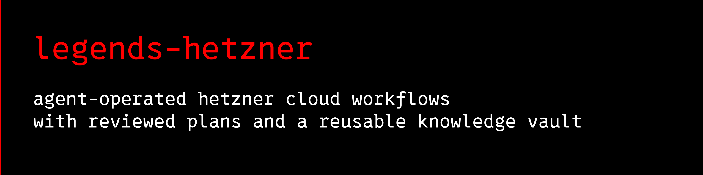

<a name="legends-hetzner"></a>

# 

[](https://github.com/avalonreset/legends-hetzner/releases/latest)
[](https://github.com/avalonreset/legends-hetzner/actions/workflows/checks.yml)
[](LICENSE)

Hetzner Cloud CLI workflows for AI agents, built on the official `hcloud` CLI.
Inspect servers, prepare reviewed provisioning plans, check SSH keys and
cloud-init inputs, and carry a source-cited operations library between sessions.

The runtime uses Python 3.10+ and works without PowerShell. Hetzner credentials
are needed only for live provider operations. The Markdown library remains
readable without an agent, a running service, or an Empire vault.

## What it adds

| Workflow | Module behavior |
| --- | --- |
| Readiness | Distinguishes local CLI readiness from a live API check. |
| Inventory and catalog | Reads structured provider data using an explicit token or named context. |
| Server planning | Writes a reviewable plan with a content hash, selected SSH keys, and a digest of optional user data. |
| Preflight | Rechecks the proposed resources and server name before a requested create operation. |
| Creation | Requires explicit approval and the reviewed plan hash; reports uncertain outcomes rather than treating a timeout as proof that nothing happened. |
| Knowledge | Ships setup, SSH, operations and troubleshooting references with an optional Empire attachment manifest. |

This is a focused operator workflow, not coverage of every Hetzner API.
It does not administer Robot bare-metal servers, automatically migrate apps,
manage billing, or replace infrastructure-as-code reconciliation.

### Why use this alongside hcloud?

Use `hcloud` directly when you want its provider commands. Legends Hetzner adds
a repeatable procedure for an agent: distinguish local readiness from API
access, save a plan for review, recheck it against current provider data, and
require that plan's hash for creation. Its documented procedures and optional
knowledge shelf help the next session pick up the same workflow.

It calls the official CLI rather than replacing it. The plan checks apply to
this module's commands; they do not restrict direct CLI or console access.

## Install with your agent

The shared [cto-legends](https://github.com/avalonreset/cto-legends) router
discovers modules before they are installed:

```console
cto-legends sync
cto-legends sync --apply
cto-legends install legends-hetzner
cto-legends install legends-hetzner --apply
cto-legends handoff legends-hetzner
cto-legends run legends-hetzner -- doctor
```

The first install command previews the operation; the second installs it.
The agent reads the module recipe through `handoff`. Only the central
`cto-legends` skill is registered. No additional host skill is required.

The separate official [`hcloud` CLI](https://github.com/hetznercloud/cli)
must be installed using its documented Windows, macOS or Linux instructions.
This module never silently installs or upgrades it.

For standalone use, install the wheel from the
[release](https://github.com/avalonreset/legends-hetzner/releases/latest) into
a virtual environment, or install the tagged source:

```console
python -m pip install "git+https://github.com/avalonreset/legends-hetzner.git@v0.1.1"
legends-hetzner doctor
legends-hetzner resources
```

`resources` locates the recipe and knowledge pack, including in a wheel
installation outside a Git checkout. On systems where Python is named
`python3`, use that command instead.

<a name="first-useful-workflow"></a>

## Quick start: inspect your Hetzner Cloud project

Configure a named project context using the official CLI's interactive setup:

```console
hcloud context create my-project
legends-hetzner --context my-project doctor --live
legends-hetzner --context my-project inventory
legends-hetzner --context my-project catalog
```

Alternatively, provide `HCLOUD_TOKEN` through your environment or secret
manager. Do not combine it with `--context`; the module rejects ambiguous
authentication. It does not search personal vaults for credentials.

### Plan and provision a server

Prepare a plan using a type, location, image and existing SSH key from the
current catalog:

```console
legends-hetzner --context my-project server plan --name example-app --type TYPE --location LOCATION --image IMAGE --ssh-key KEY --out ./server-plan.json
legends-hetzner --context my-project server preflight --plan ./server-plan.json
```

Replace the uppercase placeholders before running. Review the plan and its
printed hash, then check the proposed create without making the purchase:

```console
legends-hetzner --context my-project server create --plan ./server-plan.json --plan-hash sha256:REVIEWED_HASH --approve --dry-run
```

Removing `--dry-run` requests a paid creation. A disposable live canary has
verified creation, readback, key-based SSH, cloud-init and resource cleanup
from Windows against an Ubuntu 24.04 server. See the [tested scope](docs/VALIDATION.md)
and [repeatable canary procedure](docs/LIVE-CANARY.md). Verify SSH and bootstrap
for each new server; this evidence does not establish application health or
every client, image and location combination.

Keep plans, receipts and inventories in a private working directory outside
the installed module. Do not put secrets in cloud-init data.

For SSH-key selection, bootstrap checks and cloud-init troubleshooting, follow
the [SSH and bootstrap guide](knowledge/hetzner/vault/ssh-bootstrap.md).
The [preflight guide](knowledge/hetzner/vault/preflight.md) explains the checks
to review before provisioning.

## Optional Empire knowledge shelf

The module includes a versioned `legends.knowledge-pack/v1` pack under
`knowledge/hetzner/`. Its suggested home is
`wiki/library/legends-hetzner/hetzner` in your selected Empire.

Installation does not modify a vault. Attachment is a separate preview and
apply operation through [legends-empire](https://github.com/avalonreset/legends-empire):
it creates a user-owned index and versioned reference snapshot. Updates
preserve that index and refuse to overwrite locally edited references.
Private infrastructure decisions and evidence stay in your chosen project.

Use Empire 0.3.1+ with Python 3.11+ for native Windows attachment on a
local NTFS vault. macOS, Linux and correctly configured WSL use the POSIX
backend. Unsupported filesystem or security conditions fail before mutation;
network shares, synced folders and reparse paths are outside the native
Windows support scope. See the [attachment instructions](docs/KNOWLEDGE-PACK.md)
and [validation record](docs/VALIDATION.md).

## Coolify and MCP

Coolify is optional. This module owns provider-level inspection and provisioning
plans. Coolify owns application deployment and application-level configuration.
Use the companion [legends-coolify](https://github.com/avalonreset/legends-coolify)
for its supported application-platform workflows.

Legends Hetzner is a CLI workflow, not a Hetzner MCP server. Agents need command
execution and file access; an MCP transport is not required or bundled. The
official CLI is the provider interface, and the knowledge library records the
upstream research and boundaries.

## Architecture and how it works

```text
Operator / Agent
  -> legends-hetzner CLI (readiness, inventory, catalog, server plan)
  -> Reviewed plan JSON + SHA-256 content hash
  -> Preflight verification against live provider catalog
  -> Official hcloud CLI execution (only with --approve and matching hash)
```

- `legends_hetzner/`: Python CLI wrapper, plan hash verifier, and resource locator.
- `knowledge/hetzner/`: Attachable `legends.knowledge-pack/v1` reference pack for [`legends-empire`](https://github.com/avalonreset/legends-empire).
- `docs/`: Agent recipe, validation scope, live canary procedure, and [search strategy](docs/SEARCH-STRATEGY.md).

## FAQ

**Does `legends-hetzner` replace the official `hcloud` CLI?**
No. It wraps the official `hcloud` CLI with an agent-ready review procedure: separate local readiness from live API checks, write a hash-pinned server plan, run preflight validation, and require explicit approval before creation.

**Can I read the knowledge pack without Hetzner credentials?**
Yes. Both `legends-hetzner doctor` and `legends-hetzner resources` work offline without credentials, and the Markdown runbooks in `knowledge/hetzner/` can be read directly or attached to a [`legends-empire`](https://github.com/avalonreset/legends-empire) vault.

## Development and support

- [Agent recipe](docs/AGENT-RECIPE.md)
- [Knowledge index](knowledge/hetzner/vault/index.md)
- [Tested scope](docs/VALIDATION.md)
- [Contributing](CONTRIBUTING.md)
- [Security](SECURITY.md)
- [Support](SUPPORT.md)
- [Attribution](THIRD_PARTY_NOTICES.md)

Independent software by Benjamin Samar, released under the MIT license.
Not affiliated with or endorsed by Hetzner.
